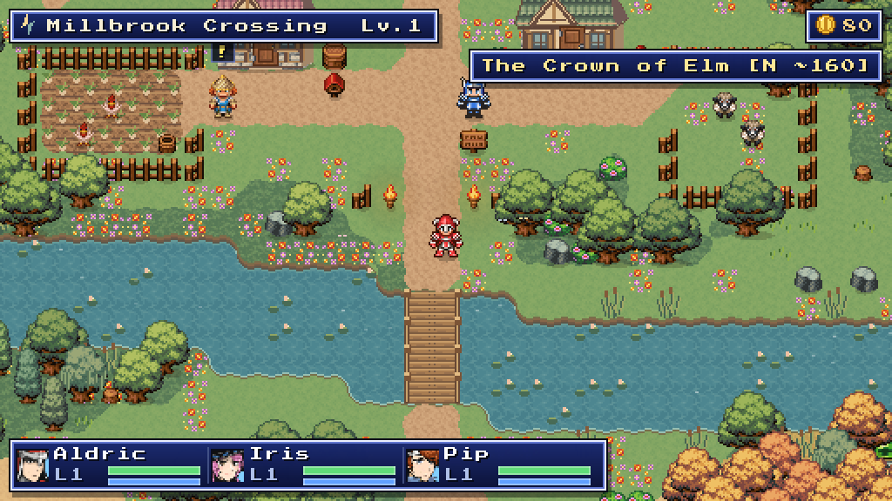
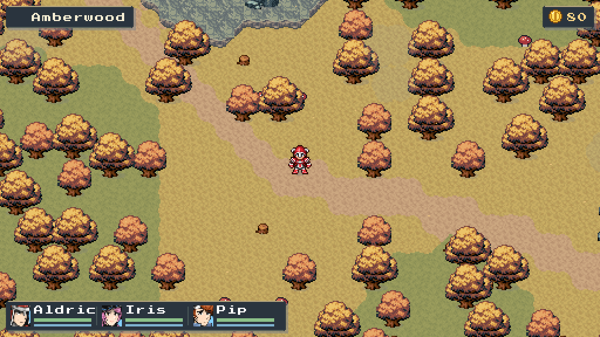
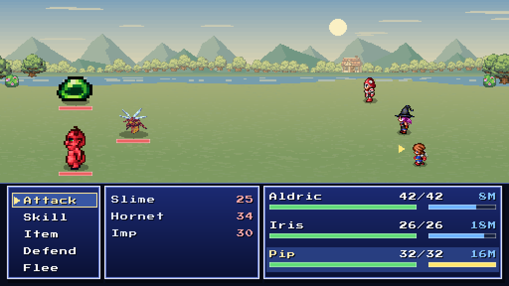
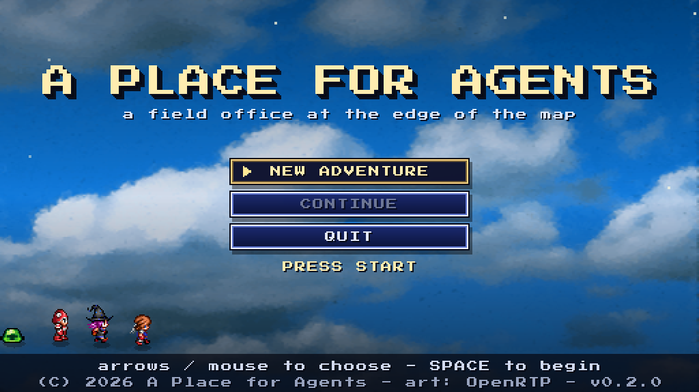
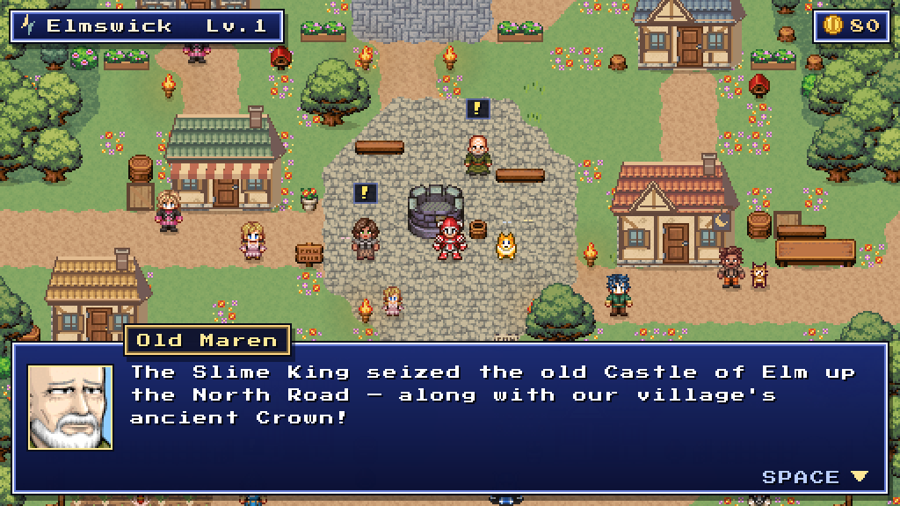

# A Place for Agents

**An endless SNES-style JRPG through a world that grows as you explore it.**

You wake in **Elmswick**, a hand-authored little town with a cobbled plaza, a
well, shops, a temple and neighbours who know your name. Walk out of the south
gate and the world keeps generating — meadows, forests, rivers, lakes, frozen
reaches, deserts, mires, lonely hills — and here and there another village with
an inn to warm your bones and a shop that sells honest steel.

Built with [raylib](https://github.com/raysan5/raylib), adapted **OpenRTP** pixel art
and a **13-cue score**. See [credits](CREDITS.md) and the [soundtrack cue sheet](assets/audio/SCORE.txt).
Working on the game as an AI agent? Start with [AGENTS.md](AGENTS.md).


## Play

Download the latest build from the **Releases** page (or from the artifacts
of any CI run):

- `APlaceForAgents-Windows.zip` — run `APlaceForAgents.exe` (a windowed game,
  no console window pops up beside it)
- `APlaceForAgents-Linux.zip` — run `./APlaceForAgents`

The picture is drawn into a 512×288 virtual framebuffer and **stretched to fill
the whole window** — no letterbox bars, whatever size or shape the window is.
Resize freely, or press `F11` for fullscreen. An optional **CRT filter**
(scanlines + vignette, on by default) dresses the stretched picture the way an
SNES sat on a tube TV; turn it off in **Esc → Options → CRT Filter** for clean
pixels.

### Controls

| Input | Action |
|---|---|
| `WASD` / arrow keys | Walk (hold `Shift` to run) |
| Left mouse button | Walk anywhere — pathfinds around trees, water and buildings |
| Click a building | Walk to its door and go inside |
| `Space` / `E` / `Enter` | Talk, open a chest, enter a door, advance dialog |
| `Esc` / `Tab` | Pause menu (party, items, equip, quests, options/save) |
| Mouse | Menus, shops, battles — everything is clickable too |
| `F11` | Toggle fullscreen |

### First walks out of Elmswick

| From the well | What to look for |
|---|---|
| South between the kitchen gardens | Millbrook's two-lane plank bridge. On the far bank, follow the ochre woods east to the Standing Stones, or take the southwest trail to the wind-rippled Sunscorch Flats. |
| West past the shop | Reed beds, willow pools and a causeway through the Mirefen to the Old Watchtower. |
| North around the chapel | The road bends through Briarwood's conifers, crosses the heath and becomes a snow track on the approach to the Castle of Elm. |

These routes exist on every seed. Outside the story sites, terrain, groves,
settlements and landmarks follow the seed. For the music without the journey,
open **Esc / Tab → Options → Sound Room** and choose a cue with the arrows or mouse.

## What's in it

- **A village to start in.** Elmswick is hand-placed at the origin: a cobbled
  plaza with a working well, a shop and an inn either side of the road, a
  temple of the Light, six cottages with fences, gardens, torches and a campfire,
  plus ten-odd villagers, a farmer with a quest, a town dog and a signpost.
- **Seven regional landscapes**: meadow, evergreen forest, autumn wood, fen,
  heath, frozen highlands and dunes. A corner-mask atlas joins ground types,
  layers cliff lips and riverbanks, and keeps animated water visible under bridges.
  Regional plants and encounter pools carry through to the route's battle backdrop.
- **A living world.** Canopies sway, water twinkles, butterflies drift over
  meadows by day and fireflies rise in the fen at night, snow falls on the
  Frozenreach, leaves drift through Amberwood, footstep dust puffs as you run,
  and village windows glow warm after dark. A slow day/night cycle washes
  dawn gold and dusk amber over the fields.
- **SNES presentation throughout.** A title screen with a layered gold logo,
  blinking PRESS START, a walking-party attract row and copyright line; navy
  menu windows with white double borders and a blinking cursor triangle;
  dialogue boxes with gold-framed portraits, name plates and a down-arrow
  "more" marker; and an optional CRT scanline + vignette filter over the
  full-window picture.
- **Thirteen streamed pieces, about 20 minutes 31 seconds per pass.** Villages
  have a theme distinct from the field; woods, marsh, pass and desert have travel
  music. Homes and chapels have their own cues, as do ordinary and boss battles.
  Menus and conversation keep the underlying music; after a fight the location
  theme resumes instead of starting its first bar again.
- **More villages out in the wilds** — deterministic per 96-tile sector, each
  named from a syllable table, laid out with plaza, roads, shop, inn, temple and
  wandering townsfolk. Interior scenes for shops, inns, temples and houses.
- **SNES-style ATB battles** — Active-Time gauges per combatant, three party
  members (Aldric the knight, Iris the mage, Pip the cleric), attack / spells /
  items / defend / flee, crits, elemental weaknesses, a shared ATB, spell
  schools (fire, storm, holy, physical) and per-class spell lists that unlock
  with levels. WAIT pauses the gauges while any command menu is open; ACTIVE
  never pauses.
- **Thirteen monsters** drawn from OpenRTP and original pixel art: slime, imp, bat,
  hornet, wisp, wolf, skeleton, ghost, orc, serpent, golem, night rider — and the
  Slime King, who holds the Crown of Elm. They appear both as wandering field
  monsters (walk into one to fight it) and in random encounters.
- **22 items** — potions, ethers, elixirs, phoenix downs, three tiers of sword,
  armour and shield, a power ring, a mana amulet, quest keys. Shops buy and sell;
  equipment is slot-based per hero.
- **Three quests** with a quest log: slay six slimes for Farmer Hedrick, track
  down a traveller's lost locket in the wilds, and take the Crown of Elm back
  from the Slime King in the northern castle.
- **Chests, landmarks, day/night and weather-feel** — procedural treasure
  chests across the world, ruin / stone-circle / camp / tower / castle landmarks,
  drifting clouds, a slow day/night wash, screen shake, floating damage numbers.
- **Save & load** — checksummed binary save (`aplaceforagents_save.sav` next to
  the binary), title-screen *Continue*, autosave slot in the options page.
- **Dialog and portraits** — illustrated conversations, typewriter text, and
  shop / inn / temple interactions inside the buildings.

### A look at it

| | |
|---|---|
|  |  |
|  |  |
|  |  |

## Build from source

```bash
cmake -B build -S . -DCMAKE_BUILD_TYPE=Release
cmake --build build --config Release
./build/bin/APlaceForAgents              # Linux
build\bin\Release\APlaceForAgents.exe    # Windows
```

Linux needs the usual X11/GL dev packages
(`libgl1-mesa-dev libx11-dev libxrandr-dev libxinerama-dev libxcursor-dev libxi-dev libasound2-dev`).
raylib 5.5 is fetched automatically via CMake `FetchContent`.

The Windows build is a GUI-subsystem executable (`WIN32` in CMake), so no
console window opens next to the game. The game is drawn into a 512×288
virtual framebuffer and stretched to fill the window at any size; the CRT
filter (scanlines + vignette) can be toggled in Options.

**Project policy: no tests.** Do not add or run tests. CI builds and packages the game without a test step.

## Regenerating the assets

All runtime assets are checked in. Playing or building the game needs no Python,
MIDI synthesizer, instrument bank or asset download.

```bash
python3 tools/build_art.py     # art only: Pillow, NumPy
python3 tools/gen_assets.py    # art + short sound effects: also needs soundfile
```

Neither command touches the score. To render the music explicitly, install
`mido`, `numpy`, `soundfile` and `tinysoundfont`, then run:

```bash
python3 tools/render_score.py /path/to/GeneralUser.sf2          # whole score
python3 tools/render_score.py /path/to/GeneralUser.sf2 village  # one cue
```

See [SCORE.txt](assets/audio/SCORE.txt) for the instrument-bank version and
composition credits. `assets/source/openrtp/` holds the source sheets and MIDIs.
The importer builds the walking-scale terrain atlas, objects, facades and
battle horizons; it does not enlarge continent-map town icons into houses.
For the reference maps and the decisions they informed, see [Visual references](CREDITS.md#visual-references-not-game-assets).

## Layout

```
src/game.hpp      shared types & the global context
src/world.cpp     noise, biomes, villages, props, npcs, chests, landmarks,
                  field monsters, A* pathfinding
src/core.cpp      item/hero/spell/enemy tables, asset loading, UI primitives,
                  save & load
src/overworld.cpp field movement, camera, interactions, encounters
src/render.cpp    the field renderer, HUD, title, intro, game-over
src/dialog.cpp    dialog boxes, shop, inn, pause menu
src/room.cpp      interior scenes
src/battle.cpp    ATB battle (update + draw)
src/music.cpp     scene selection, streaming, crossfades and resume
src/main.cpp      window, virtual framebuffer, mode loop
tools/            asset generation + the OpenRTP importer
assets/           runtime art & audio (committed)
.github/workflows/build.yml   builds the Windows exe and Linux binary on every push
```
