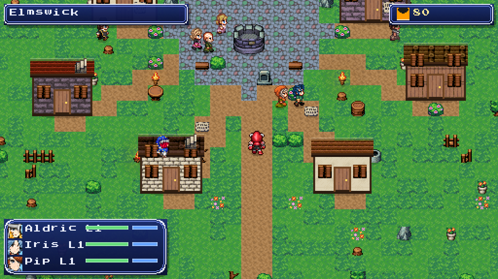
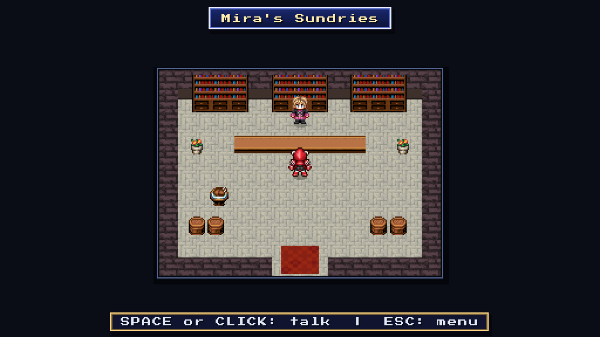

# A Place for Agents
(NO TEST // NO AGENTS.md)
**An endless, 16-bit-inspired JRPG about the people you send beyond the map.**

Elmswick is the last field office on a charted road. When the maps end, its
agents begin: Aldric keeps the way open, Iris reads what the old maps leave
out, and Pip makes sure everyone gets home. Follow their assignment through a
hand-built village and into a world that grows as you explore it: quiet meadows,
old forests, river crossings, remote settlements, forgotten landmarks, and a
king who has made off with the village crown.



Built in C++17 with [raylib 5.5](https://github.com/raysan5/raylib), adapted
OpenRTP pixel art and a streamed 13-cue score. See [credits and licenses](CREDITS.md)
and the [soundtrack cue sheet](assets/audio/SCORE.txt). If you are working on
the game as an agent, the repository guide is [AGENTS.md](AGENTS.md).

## Play

Download a build from the **Releases** page or the artifacts of a CI run:

- **Windows:** `APlaceForAgents-Windows.zip` — run `APlaceForAgents.exe`.
  It opens as a normal window, without a console window beside it.
- **Linux:** `APlaceForAgents-Linux.zip` — run `./APlaceForAgents`.

The game renders to an aspect-adaptive pixel-art canvas (512×288 at 16:9,
expanding the field of view cleanly on wider or taller windows instead of
adding black letterbox bars or distorting square pixels) and blits to the full
window via integer pre-upscaling for crisp pixel edges at any resolution or
borderless fullscreen (`F11` or `Alt+Enter`). The optional **Soft CRT**
treatment is off by default; enable it in **Esc → Options** for faint,
image-aligned scanline shading. Clean pixels are always available.

### Controls

| Input | Action |
|---|---|
| `WASD` / arrow keys | Walk (cardinal movement; hold `Shift` to run) |
| Left mouse button | Click to walk; the party routes around obstacles |
| Click a building | Walk to its door and enter |
| `Space` / `E` / `Enter` | Talk, open a chest, enter a door, or advance dialogue |
| `Esc` / `Tab` | Open or close the pause menu |
| Mouse | Use menus, shops and battle commands |
| `F11` / `Alt+Enter` | Toggle borderless fullscreen |

### First routes from the Elmswick well

| Direction | Route |
|---|---|
| South | Cross Millbrook's plank bridge. Follow the ochre woods east to the Standing Stones, or take the southwest trail to the Sunscorch Flats. |
| West | Find reed beds, willow pools and a causeway through Mirefen to the Old Watchtower. |
| North | Circle the chapel, follow the road through Briarwood and the heath, then climb the snow track to the Castle of Elm. |

These story routes are fixed; beyond them, the seed shapes the terrain,
settlements, landmarks and treasure. Use the **Sound Room** in **Esc → Options**
to listen to the score without roaming the wilds.

## In the field

- **A place to start.** Elmswick has a cobbled plaza, well, shop, inn, temple,
Aldwin's Forge, a market quarter, ridge and orchard cottages, a graveyard,
gardens, fences, torches, a campfire, neighbours, a farmer with a request, a
dog and a signpost. The forge uses the same textured slate and masonry as the
cottages, with a recessed hearth, a clear central door and a working yard.
Inside are a stone furnace, an iron anvil, storage and a clear visitor aisle,
not dining furniture standing in for smithing equipment.
The added homes occupy spaced ridge, chapel and orchard plots rather than
overlapping existing roofs and decorations. Generated villages reserve a
smithy before placing cottages and route shared lanes around building envelopes.
- **Seven regions.** Meadows, evergreen woods, autumn forests, fen, heath,
frozen highlands and dunes have different ground, plants, encounter pools and
battle horizons. Corner-masked ground transitions, banks, cliffs and river
crossings are composed from tiles rather than one stretched map image.
- **A world with a little weather in it.** Tree canopies sway, water glints,
butterflies cross meadows, fireflies drift through the fen, snow falls in the
Frozenreach and leaves move through Amberwood. A slow day/night wash, warm
village windows and footstep dust give places a changing mood.
- **Places worth finding.** Deterministic villages, inns, shops, temples,
houses, camps, ruins, stone circles, towers, castles and chests appear across
the generated world. Interiors have their own small scenes. Stone mouths in
the hills open into **procedurally generated cavern dungeons**: a connected BSP backbone weathered into irregular chambers, alcoves and
passages, natural rock and mineral formations, roaming inhabitants, treasure,
multiple floors and a deep vault — always the same layout for the same seed.
The rare deep crypt keeps its built stone halls. Cavern treasure, creature and
stair locations remain compatible with earlier saves. **To find a cave:** leave Elmswick by the west gate and follow the
causeway until the short northbound dirt spur to **Hollow Hill** (four floors).
A second seeded mouth lies just east of the north road in Briarwood. Both
are guaranteed; further hillside caverns use their own 64-tile sector survey,
not the decorative-landmark lottery. Click a cave mouth to walk up and enter,
or press **Space / E / Enter** at its threshold. A lantern-revealed
survey map tracks visited passages across floors during the current cavern
visit (white: party, teal: ascent, blue: descent, gold: unopened treasure).
Field HP/MP gauges and KO/poison badges keep party condition visible.
Existing v5 saves still load, but this generation revision changes cavern
entrance positions and village plots; old entrance locations are not retained.
Furniture respects traversable routes; click-to-move routes around it and
chooses a reachable approach to treasure. Defeated cavern inhabitants stay
cleared, including after leaving and returning; fleeing does not clear them.
- **Four quests.** Help Farmer Hedrick with the slimes, find a traveller's lost
locket, recover the Crown of Elm from the Slime King, and bring star metal up
from the deep vaults for Nell at the forge. The quest log tracks progress and
points toward story destinations.
- **Field encounters and a party.** Aldric (Knight), Iris (Mage) and Pip
  (Cleric) have distinct strengths. Twenty-three enemy species roam the world
  (plus the Slime King); walking into a visible field monster starts that fight.
  The expanded OpenRTP roster includes bandits, goblins, spirits, dragons and
  wilderness beasts.
- **44 items and equipment slots.** Tiered potions, ethers, smoke bombs,
remedies, eight weapon lines (swords, axes, polearms, daggers, bows, maces,
rods, staves), five armour sets, robes, shields, stat rings and quest items.
Mira sells sundries; Aldwin's Forge sells weapons and armour only, with better
gear unlocking as the story advances. Equip weapons, armour and accessories per
hero — class-restricted gear only fits its class.

### Battles and progression

Battles use an Active-Time system with **WAIT** (gauges pause while a command
menu is open) and **ACTIVE** (gauges keep moving). Attack, spells, items, defend
or flee; use physical and elemental skills, exploit weaknesses, change party
rows, and unlock class-specific abilities as the party levels up. Spells include
fire, storm, holy and physical schools. Ordinary fights and the Slime King have
their own music and battle presentation.

### A SNES-inspired picture, not an emulator filter

The look comes first from the art and composition: chunky 16-pixel ground
cells, reusable tile patterns, palette-conscious warm terrain and cool shadows,
layered scenery, readable sprites, and navy-and-gold windows. The framebuffer
is intentionally larger and wider than an SNES's common 256×224 display mode;
this is a modern, widescreen-friendly homage, not a claim of hardware-accurate
rendering.

The **Soft CRT** option is intentionally restrained: it adds a very low-contrast
beam shadow aligned to each source row and a slight edge falloff. It is off by
default so it cannot obscure fine details. The original SNES used tile-based
background layers and palette groups (with color depth varying by graphics
mode); the [SNESdev background guide](https://snes.nesdev.org/wiki/Backgrounds)
and [tile formats reference](https://snes.nesdev.org/wiki/Tiles) are useful
technical introductions. The game borrows the readable layering and tile
craft, not the hardware limits. For more about screen scaling and the difference
between pixel art and display simulation, see Unity's
[2D Pixel Perfect guide](https://unity.com/blog/games/2d-pixel-perfect-how-to-set-up-your-unity-project-for-retro-16-bit-games).

### Music, menus and saves

- **Thirteen streamed cues**, around 20 minutes 31 seconds per pass. Each
  location has a musical identity; dialogue and menus leave the current cue
  playing, and returning from a battle resumes the location theme.
- **Menus throughout:** party, items, equipment, quests, save/options and a
  Sound Room. Keyboard and mouse work in menus and combat.
- **Save and continue:** checksummed save file `aplaceforagents_save.sav` next
  to the executable. Save from **Esc → Options** or continue from the title
  screen. Set `APFA_SAVE` to choose a different save path.
- **Transitions and feedback:** fades, screen shake, floating damage, quest
markers, interaction prompts and typewriter dialogue with portraits.

### Screenshots

| | |
|---|---|
|  |  |
|  |  |
|  |  |

## Build from source

```bash
cmake -B build -S . -DCMAKE_BUILD_TYPE=Release
cmake --build build --config Release
./build/bin/APlaceForAgents               # Linux
build\bin\Release\APlaceForAgents.exe     # Windows
```

Linux needs X11/OpenGL and audio development packages, including
`libgl1-mesa-dev libx11-dev libxrandr-dev libxinerama-dev libxcursor-dev
libxi-dev libasound2-dev`. CMake fetches raylib 5.5 via `FetchContent`.
Runtime assets are checked in and copied beside the executable at build time;
playing does not require Python, a MIDI synthesizer or an instrument bank.

The Windows executable uses the GUI subsystem. CI builds and packages Windows
and Linux binaries. **Project policy: no tests.**

## Art system, manifest and validation

The one art dialect is **EasyRPG/OpenRTP** (vendored at
`assets/source/openrtp/`), adapted by `tools/import_openrtp.py` — keep it,
credit it, build on it. The contract, palette, terrain system, UI finish
and the guardrail against ever replacing the OpenRTP art are in
[docs/ART_BIBLE.md](docs/ART_BIBLE.md); per-file provenance for all 384
asset files is in the generated [ART_MANIFEST.md](ART_MANIFEST.md).

```bash
python3 tools/generate_manifest.py   # rebuild ART_MANIFEST.md after adding/renaming an asset
python3 tools/validate_assets.py     # dimensions, manifest parity, code refs, UI finish, OpenRTP guardrails
```

`validate_assets.py` is an asset validator (not a test suite) and runs in
CI; it fails if the OpenRTP import pipeline or credits are removed, if a
runtime file is missing from the manifest, or if art leaves the contract
sizes. **Never** regenerate runtime PNGs to replace OpenRTP-derived art.

## Regenerating assets

All runtime assets are committed. These optional tools regenerate art and sound
effects; Python dependencies are only needed if you are editing the source art.
After regenerating, re-run the manifest + validator commands above.

```bash
python3 tools/build_art.py     # art only: Pillow, NumPy
python3 tools/gen_assets.py    # art + short SFX: also needs soundfile
```

To render the score explicitly, install `mido`, `numpy`, `soundfile` and
`tinysoundfont`, then run:

```bash
python3 tools/render_score.py /path/to/GeneralUser.sf2          # whole score
python3 tools/render_score.py /path/to/GeneralUser.sf2 village  # one cue
```

See [SCORE.txt](assets/audio/SCORE.txt) for the cue list and composition
credits. The instrument bank is not redistributed. See
[Visual references](CREDITS.md#visual-references-not-game-assets) for the
references used while designing the terrain and walking-scale world.

## Repository map

```text
src/game.hpp      shared types and game state
src/world.cpp     seeded terrain, villages, props, NPCs, landmarks, pathfinding
src/overworld.cpp field movement, camera, interactions and encounters
src/render.cpp    field renderer, HUD, title, intro and game-over screens
src/dialog.cpp    dialogue, shops, pause menu and options
src/room.cpp      building interiors
src/battle.cpp    battle update, commands, effects and presentation
src/dungeon.cpp   procedural cavern dungeons (BSP floors, loot, descent)
src/core.cpp      asset loading, UI primitives, saves and game tables
src/main.cpp      window, pixel-perfect presentation, mode loop
assets/           runtime pixel art, font and audio
tools/            art generation, importers and score rendering
```

## What this is

An endless SNES-style JRPG in C++17 with [raylib](https://github.com/raysan5/raylib) 5.5.
You start in the hand-authored village **Elmswick** and the world generates
procedurally around you: seven biomes, generated villages, landmarks, chests,
field monsters, ATB battles, four quests, shops/inns/temples/forge, procedural
cavern dungeons, interiors, save/load, and a 13-cue streamed score. Current
version: **0.2.0** (see `CMakeLists.txt`).

## Build & run

```bash
cmake -B build -S . -DCMAKE_BUILD_TYPE=Release
cmake --build build --config Release
./build/bin/APlaceForAgents              # Linux
build\bin\Release\APlaceForAgents.exe    # Windows (GUI subsystem, no console)
```

Linux needs X11/GL dev packages (`libgl1-mesa-dev libx11-dev libxrandr-dev
libxinerama-dev libxcursor-dev libxi-dev libasound2-dev`). raylib is fetched
by CMake `FetchContent` — no vendored copy. Runtime assets live in `assets/`
and are copied next to the binary by a post-build step; the game also finds
`assets/` relative to the working directory or the exe.

**Project policy: no tests.** Do not add or run tests. CI (`.github/workflows/build.yml`)
only builds and packages the Windows exe and Linux binary.

## How the game is put together

- `src/game.hpp` — shared types and the global `Game g` context. Everything
  hangs off this header; new shared state goes here.
- `src/main.cpp` — window, aspect-adaptive virtual framebuffer (`g.vw`×`g.vh`,
  512×288 base), full-window integer-oversampled presentation, borderless
  fullscreen (`F11` / `Alt+Enter`), optional restrained CRT shading, mode loop
  and fade transitions. `getVirtualMouse()` maps window coordinates cleanly to
  the active virtual canvas.
- `src/world.cpp` / `src/world.hpp` — deterministic noise, biomes, the
  Millbrook river and story trails, villages, props, NPCs, chests, landmarks,
  field monsters, A* pathfinding. Rendering, collision and pathfinding all
  read `propAt()` / `sampleGround()` so they cannot disagree.
- `src/overworld.cpp` — field movement (cardinal-only keyboard, click-to-move
  with A*), camera, encounters, interactions, prompts.
- `src/render.cpp` — Y-sorted field renderer, HUD, title/intro/game-over,
  dialogue box. SNES look: navy windows with white double borders, gold
  accents, Press Start 2P, blinking cursor triangles.
- `src/dialog.cpp` — dialogue, pause menu (Party/Items/Equip/Quests/Options),
  shop, inn, Sound Room.
- `src/room.cpp` — interiors (shop/inn/temple/house).
- `src/battle.cpp` — side-view ATB battle (WAIT pauses gauges in menus,
  ACTIVE never pauses).
- `src/music.cpp` — one music director: scene → cue, crossfades, resume.
- `src/core.cpp` — item/hero/spell/enemy tables, asset loading, UI
  primitives, save/load (checksummed `SaveBlob`, version 4).

## Conventions to keep

- **Determinism:** world gen is a pure function of `(tx, ty, worldSeed)`.
  Never depend on visit order or camera position for what exists.
- **SNES feel:** 16px tiles, corner-mask autotiling, warm pastel palette with
  cool/purple shadows (see `tools/snes.py`), navy+gold UI, Press Start 2P at
  multiples of 8px. No modern rounded-glass UI.
- **Assets are committed.** `tools/build_art.py` / `tools/gen_assets.py`
  regenerate art + SFX; `tools/render_score.py` renders the score from
  `assets/source/openrtp/` MIDIs. Playing/building needs none of these.
- **Saves:** `aplaceforagents_save.sav` next to the binary. Changing
  `SaveBlob` layout breaks old saves (size check) — prefer reusing flag bits.
- **Windows:** the exe must stay a GUI-subsystem build (`WIN32` in CMake) —
  no console window. Don't add `printf`-only debugging that needs a console.

## Where to look for things

- Controls / first walks / what's in the game: [README.md](README.md)
- Art, music and font licenses + visual references: [CREDITS.md](CREDITS.md)
- Cue sheet (titles, durations, licenses): `assets/audio/SCORE.txt`
- Screenshots: `docs/screenshots/`
